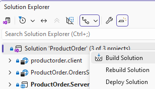
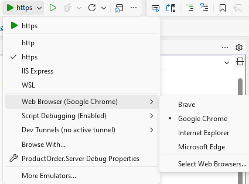

# ProductOrder

ProductOrder is a local development application with a React/TypeScript client, a .NET 10 Products API backed by SQL Server, and a separate NestJS Orders API backed by Elasticsearch.

## Plug and Play

A runtime_handoff directory is included for quick runtime deployment without the source repository. See runtime_handoff/README.md for instructions and prebuilt images to run the full stack via Docker with minimal setup.

## Run the whole solution with Docker Compose

Prerequisite: Docker Desktop configured to use Linux containers. From the repository root, create a local environment file:

```powershell
Copy-Item .env.example .env
docker compose up --build
```

Open the client at `http://localhost:52579`. The Products API is available at `http://localhost:5268/api/products`, the Orders API at `http://localhost:3001`, Elasticsearch at `http://localhost:9200`, and SQL Server at `localhost:1433`. The APIs wait for their database/search dependencies to become healthy; the Products API applies its EF Core migration on startup.

All published ports bind to `127.0.0.1`. The local Elasticsearch service has security disabled, so do not change these bindings or expose it to an untrusted network. SQL Server uses the Developer edition, intended only for development and testing. SQL Server and Elasticsearch data persist in named Docker volumes when containers stop.

Useful commands from the repository root:

```powershell
docker compose logs -f
docker compose down
```

`docker compose down` removes the containers but preserves database/search data. To also delete that data, run `docker compose down --volumes`.

Ports and image settings can be overridden in `.env`; see `.env.example`. The local `.env` is ignored by Git. The Vite development proxy routes `/api/products` to the .NET API and `/api/orders` to the Orders API. The client checkout form submits customer details and cart items to `POST /api/orders`; saved documents appear on the Orders page. `GET /api/orders` returns the latest documents, and `GET /health` is the Orders API liveness endpoint.

## Run services manually

The Elasticsearch-only Compose setup remains available if you prefer to run the APIs and client outside Docker. From the repository root:

```powershell
Copy-Item ProductOrder.OrdersServer/.env.example ProductOrder.OrdersServer/.env
docker compose -f ProductOrder.OrdersServer/docker-compose.yml up -d
```

There should also be a reachable SQL Server instance and a valid connection string in ProductOrder.Server/appsettings.json (key "ConnectionStrings:Products"). If the configured SQL Server instance is reachable and the connection user has permission to create a database, EF migrations in this project will create the PRODUCTS database and schema automatically; otherwise you must create the PRODUCTS database yourself (or run the provided SQL script) before applying migrations.


Install Node dependencies in `ProductOrder.OrdersServer` and `productorder.client` then Run ProductOrder.Server:
```powershell
dotnet run --project ProductOrder.Server
```
`dotnet run` starts the Products (.NET) API; automatic launching of the client and Orders API happens because of the SPA proxy configuration in `ProductOrder.Server.csproj` and the client `dev` script using `concurrently`. If needed run the NestJS API and Vite client using their npm scripts. 

Open the client at `https://localhost:52579`. The Products API is available at `http://localhost:5268/api/products`, the Orders API at `http://localhost:3001`, Elasticsearch at `http://localhost:9200`. The APIs wait for their database/search dependencies to become healthy; the Products API applies its EF Core migration on startup.

Example order request:

```json
 {
  "first_name" : "Moshe",
  "last_name" : "Israel",
  "address" : "Kikar ha-Medina 1",
  "mail" : "mail@gmail.com",
  "datetime" : "2026-10-12T19:08:16.802Z",
  "items" : [
    {
      "code_product" : "2",
      "code_category" : "1",
      "descr_product" : "Milk 3%",
      "quantity" : 3
    },
    {
      "code_product" : "12",
      "code_category" : "4",
      "descr_product" : "Onion",
      "quantity" : 4
    }
  ]
}
```

The API assigns `datetime` in UTC when an order is saved. The Elasticsearch mapping is defined in `ProductOrder.OrdersServer/orders.mapping.json` and uses snake_case field names with nested order items.

## Run and edit code by Visual Studio 2026 or VSCode, Elasticsearch run by Docker
Run Elasticsearch:
```powershell
Copy-Item ProductOrder.OrdersServer/.env.example ProductOrder.OrdersServer/.env
docker compose -f ProductOrder.OrdersServer/docker-compose.yml up -d
```
There should also be a reachable SQL Server instance and a valid connection string in ProductOrder.Server/appsettings.json (key "ConnectionStrings:Products"). If the configured SQL Server instance is reachable and the connection user has permission to create a database, EF migrations in this project will create the PRODUCTS database and schema automatically; otherwise you must create the PRODUCTS database yourself (or run the provided SQL script) before applying migrations.

Set ProductOrder.Server as startup project. Build Solution (It will set up NuGet packages and npm dependencies):


#### Configure the client to launch in Chrome 


## Database migrations

The initial migration is checked in and applied automatically by the .NET app at startup. To scaffold additional schema changes after updating the EF model, run:

```powershell
dotnet ef migrations add <MigrationName> --project ProductOrder.Server
dotnet ef database update --project ProductOrder.Server
```

## Client checks

```powershell
cd productorder.client
npm install
npm run build
npm run lint
```

## Orders API checks

```powershell
cd ProductOrder.OrdersServer
npm install
npm run build